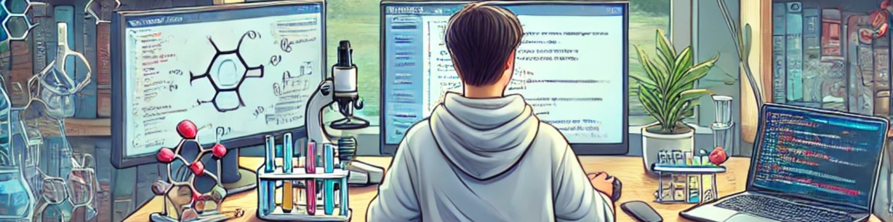

Hi  My name is Md. Habibullah
=======================================================================================================================================

Frontend developer. Programming Hero Student
--------------------------------------------

* 🌍  I'm based in Bangladesh
* ✉️  You can contact me at [hello@mdhabibullah.com](mailto:hello@mdhabibullah.com)
* 🚀  I'm currently working on [10SecKitchen website](http://10seckitchen.com)
* 🧠  I'm currently learning Nextjs, Typescript
* 👥  I'm looking to collaborate on Frontend Project ( React, HTML/CSS)

### Socials

 <a href="https://www.github.com/habibullah1090" target="_blank" rel="noreferrer"> <picture> <source media="(prefers-color-scheme: dark)" srcset="https://raw.githubusercontent.com/danielcranney/readme-generator/main/public/icons/socials/github-dark.svg" /> <source media="(prefers-color-scheme: light)" srcset="https://raw.githubusercontent.com/danielcranney/readme-generator/main/public/icons/socials/github.svg" />  </picture> </a> <a href="https://www.x.com/habibullah1090" target="_blank" rel="noreferrer"> <picture> <source media="(prefers-color-scheme: dark)" srcset="https://raw.githubusercontent.com/danielcranney/readme-generator/main/public/icons/socials/twitter-dark.svg" /> <source media="(prefers-color-scheme: light)" srcset="https://raw.githubusercontent.com/danielcranney/readme-generator/main/public/icons/socials/twitter.svg" />  </picture> </a> <a href="https://www.linkedin.com/in/habibullah1090" target="_blank" rel="noreferrer"> <picture> <source media="(prefers-color-scheme: dark)" srcset="https://raw.githubusercontent.com/danielcranney/readme-generator/main/public/icons/socials/linkedin-dark.svg" /> <source media="(prefers-color-scheme: light)" srcset="https://raw.githubusercontent.com/danielcranney/readme-generator/main/public/icons/socials/linkedin.svg" />  </picture> </a> <a href="https://www.codepen.io/habibullah1090" target="_blank" rel="noreferrer"> <picture> <source media="(prefers-color-scheme: dark)" srcset="https://raw.githubusercontent.com/danielcranney/readme-generator/main/public/icons/socials/codepen-dark.svg" /> <source media="(prefers-color-scheme: light)" srcset="https://raw.githubusercontent.com/danielcranney/readme-generator/main/public/icons/socials/codepen.svg" />  </picture> </a> <a href="https://www.facebook.com/habibullah1090" target="_blank" rel="noreferrer"> <picture> <source media="(prefers-color-scheme: dark)" srcset="https://raw.githubusercontent.com/danielcranney/readme-generator/main/public/icons/socials/facebook-dark.svg" /> <source media="(prefers-color-scheme: light)" srcset="https://raw.githubusercontent.com/danielcranney/readme-generator/main/public/icons/socials/facebook.svg" />  </picture> </a>

### Badges

<b>My GitHub Stats</b>

<!--
**habibullah1090/habibullah1090** is a ✨ _special_ ✨ repository because its `README.md` (this file) appears on your GitHub profile.

- Here are some ideas to get you started:

- 🔭 Working on frontend development projects
- 🌱 Learning TypeScript and Next.js
- 💻 Skilled in HTML, CSS, JavaScript, and React

## 🛠️ Skills

- 🔭 I’m currently working on ...
- 🌱 I’m currently learning ...
- 👯 I’m looking to collaborate on ...
- 🤔 I’m looking for help with ...
- 💬 Ask me about ...
- 📫 How to reach me: ...
- 😄 Pronouns: ...
- ⚡ Fun fact: ...
-->
